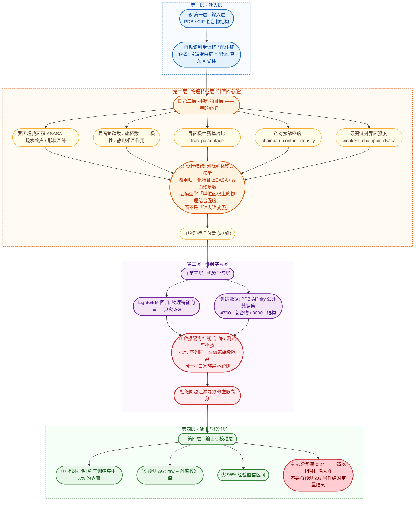

# Affinity Intelligence — 蛋白-蛋白结合亲和力排序引擎

[English README](README_EN.md) | **中文**

> 一个基于**物理化学界面特征 + LightGBM** 的蛋白-蛋白结合亲和力（ΔG）**相对排序**引擎。
> 输入一个复合物 3D 结构，输出"这个界面在已知数据里算强还是弱"。

---

## 1. 项目简介

### 我们要解决的痛点

传统结构置信度指标（如 **ipTM**、**ipSAE**）能回答"两个蛋白**能不能**结合"（**分类**问题），
但无法回答"结合得**有多紧**"（**回归**问题）。

而在真实科研与比赛场景中，最终裁判是**湿实验测出的亲和力（Kd）**。
预测绝对 Kd 数值在学术界仍是未解难题，因此本项目**不追求绝对定量**，而是构建一个
**基于物理化学特征、面向湿实验的相对亲和力排序引擎**。

### 一句话总结引擎的价值

> 它不告诉你的候选蛋白"结合得有多紧（绝对 Kd）"，
> 但它能告诉你在几百条候选里，**"哪几条最有可能在湿实验中结合得最紧"**，
> 从而大幅提升实验命中率。

---

## 2. 算法逻辑：宏观设计哲学与数据流架构

> 本章描述的是**引擎的设计思想与数据流**，而非逐行代码细节。

### 2.1 四层宏观架构（数据流图）



> 上图可直接在 GitHub 上渲染（GitHub 原生支持 Mermaid）。
> 若你的 Markdown 查看器不支持 Mermaid，请改看 `README.md` 第 2.2 节的逐层文字说明。

### 2.2 逐层说明

**第一层 · 输入层**
接收一个蛋白质复合物的 3D 结构（PDB 文件），自动识别受体链与配体链。
支持手动指定链，也支持"自动推断最短链"。

**第二层 · 物理特征层（引擎的心脏）**
从复合物界面上提取反映**真实结合驱动力**的物理化学特征。这里的关键设计取舍是：
**主动剥离"体积规模"信息**。因为一个又大又松散的界面天然拥有更多接触数与更大埋藏面积，
如果直接把这些绝对量喂给模型，模型学到的会是"谁大谁就强"这一伪相关，而非结合机理。

因此我们用两类手段处理：
- **归一化**：把绝对量化为强度量，例如 `ΔSASA / 界面残基数`、`接触数 / 链对数`、`氢键数 / 接触数`；
- **替换**：用"最弱链对界面强度"这类刻画**多点结合中最薄弱环节**的量，
  替代"总接触数"这类单调随规模增长的量。

**第三层 · 机器学习层**
使用 LightGBM 梯度提升回归模型，在 PPB-Affinity 公开数据集上学习
"物理特征向量 → 真实 ΔG"的非线性关系。

数据隔离是这一层的**红线**：训练集与测试集严格按 **40% 序列同一性**做**家族级隔离**
（单链接/贪心代表聚类 → 整族分侧），确保同一个蛋白家族绝不跨侧。
这一步是必须的——我们实测发现，若仅按 PDB 级别划分，会有约 30% 的测试样本
属于"训练集中已出现过的同源家族"，从而把指标抬高到不真实的水平。

**第四层 · 输出与校准层**
- 输出**相对排名**（"强于训练集中 X% 的界面"）——这是最可靠的指标；
- 输出**预测 ΔG**（raw 原始值 + 斜率校准值），并附 **95% 经验置信区间**；
- 附带明确的使用警告：模型绝对数值存在收缩（拟合斜率 **0.24**），请以相对排名为准。

---

## 3. 模型性能

在**跨家族隔离**测试集上的实测结果：

| 指标 | 数值 |
|---|---|
| **Spearman（核心指标，排序一致性）** | **0.534** |
| 95% 置信区间 | [+0.487, +0.580] |
| **RMSE** | **2.37 kcal/mol** |
| MAE | 1.78 kcal/mol |
| R² | 0.261 |
| 测试集规模 | **950 行 / 437 个未见家族 / 580 个结构** |
| 训练集规模 | 3800 行 / 1973 个家族 |
| 置换检验 | OOF 超随机基线 **18.1σ**（信号真实） |

**版本演进（全部在家族隔离口径下）**

| 版本 | 训练数据 | 测试集 Spearman |
|---|---|---|
| V0.2（初版） | 397 行 | +0.409 |
| V1.0（数据扩至 7 倍） | 2888 行 | +0.469 |
| **V1.1（当前，全量补全）** | **4750 行** | **+0.534** |

**特征重要性 Top 5**

| 排名 | 特征 | 物理含义 |
|---|---|---|
| 1 | `frac_polar_iface` | 界面极性残基占比 |
| 2 | `n_contact_pairs` | 界面接触原子对数 |
| 3 | `n_res_lig` | 配体链残基数 |
| 4 | `chainpair_contact_density` | 链对平均接触数（V0.3 新增） |
| 5 | `frac_helix_iface` | 界面螺旋残基占比 |

> 完整的特征重要性见 `features/v1.1_feature_importance.csv`，
> 完整评估报告见 `features/v1.1_final_report.md`。

---

## 4. 环境安装

```bash
pip install -r requirements.txt
```

核心依赖：`pandas`、`numpy`、`scipy`、`scikit-learn`、`lightgbm`、
`biopython`、`freesasa`、`matplotlib`、`streamlit`。

**说明与常见问题**
- 本项目为**纯 CPU** 实现，无需 GPU，**不依赖 PyTorch / TensorFlow**。
- Windows 上若 `import lightgbm` 报 `lib_lightgbm.dll ... not found`，
  通常是因为系统缺少 VC++ 运行库中的 OpenMP 组件 `vcomp140.dll`。
  本项目已在代码内做了兼容处理（自动借用 scikit-learn 自带的同名 DLL），
  若仍报错可安装 [Microsoft Visual C++ Redistributable](https://aka.ms/vs/17/release/vc_redist.x64.exe)。
- `freesasa` 用于计算 SASA（溶剂可及表面积），是本引擎 ΔSASA 特征的基础。

---

## 5. 使用方法

### 5.1 命令行用法

```bash
# 指定链
python scripts/predict_affinity.py --pdb data/pdb/1A22.pdb --ligand A --receptor B

# 不指定链 (自动推断: 最短蛋白链 = 配体, 其余 = 受体)
python scripts/predict_affinity.py --pdb data/pdb/1ACB.pdb

# 可选参数
#   --model <path>     指定模型文件 (缺省 models/affinity_engine_v1.1.pkl)
#   --no-calibrate     关闭斜率校准
```

输出示例：

```
--- 界面 ---
配体链      : A   受体链: B
界面接触对  : 766   氢键: 18   盐桥: 6   埋藏面积 ΔSASA: 2665 Ų

预测 ΔG (raw)       : -10.99 kcal/mol
斜率校准后估计      : -13.86 kcal/mol  (测试集拟合斜率=0.24, 模型向均值收缩)
相对排名            : 强于训练集中 64.9% 的界面
定性判读            : 中等偏强
95% 预测区间 (raw)  : [-15.62, -6.36] kcal/mol
```

### 5.2 Streamlit 前端用法

**方式 A：Windows 一键启动（推荐给不熟悉命令行的同学）**

直接**双击**项目根目录下的 `run_app.bat` 即可。脚本会自动：
定位 Python 解释器 → 检查 Streamlit 是否已安装（缺失时询问是否自动安装依赖）
→ 启动应用并打开浏览器。

**方式 B：命令行启动**

```bash
cd <项目根目录>
python -m streamlit run app.py
```

浏览器打开 `http://localhost:8501` 即可。

界面功能：
- 两种结构来源：从 `data/pdb/` 选择，或**直接上传 PDB 文件**（上传文件写入临时文件，
  预测后立刻删除，不污染数据目录）；
- 链选择下拉框，支持"自动推断最短链"；
- 结果区：大字号显示**相对排名**、raw / 校准 ΔG、95% 经验区间、
  候选的 Top 5 物理特征柱状图。

> 提示：若 `streamlit` 命令找不到，请使用 `python -m streamlit run app.py`
> （某些环境下 pip 的 Scripts 目录不在 PATH 上）。

### 5.3 作为 Python 库调用

```python
import sys
sys.path.insert(0, "scripts")
from predict_affinity import get_prediction

r = get_prediction("data/pdb/1A22.pdb", ligand_chain="A", receptor_chain="B")
print(r["raw_dG"], r["calibrated_dG"], r["rank_pct"])
print(r["top_features"])          # [(特征名, 数值), ...]
```

---

## 6. 结果解读 ⚠️ 重要警告

> ### ⚠️ 模型绝对数值存在收缩（拟合斜率 0.24），请以相对排名为准，
> ### 不要将预测 ΔG 当作绝对定量结果。

具体含义：

1. **预测 ΔG 被强烈压缩向训练集均值。** 测试集上"预测值 ~ 真实值"的线性拟合斜率
   仅约 **0.24**（完美校准应为 1.0）。也就是说，真实很弱的界面会被预测得偏强，
   真实很强的界面会被预测得偏弱——**排序仍然正确，但绝对幅度失真**。
2. **斜率校准值（calibrated ΔG）** 是按该斜率还原后的估计，定量上更接近真实，
   但同时也**放大了噪声**，区间会变得很宽，请谨慎使用。
3. **推荐用法**：把输出当作**富集/筛选工具**——
   用"强于训练集中 X%"的相对排名，从几百条候选里挑出最值得做湿实验的少数几条。
4. 置信区间为**基于测试集 RMSE 的经验区间**（±1.96×RMSE），
   并非严格统计意义上的后验预测区间。

---

## 7. 局限性说明

1. **仅使用物理特征，未引入序列语言模型特征。**
   当前版本完全基于复合物界面的几何与物理化学量（ΔSASA、氢键、盐桥、接触、
   残基组成等），**未引入 ESM-2 等蛋白语言模型嵌入**。
   序列层面的进化信息与共进化信号尚未被利用，这是当前最主要的性能天花板来源之一。
2. **PRODIGY 不可用。** 原计划引入 PRODIGY 的经验能量项（predicted ΔG）作为特征，
   但目标环境中该依赖不可用，因此 `predicted_dG` 整列缺失，模型仅使用几何/物化特征。
3. **训练数据规模有限。** 当前使用 PPB-Affinity 中 ~3000 个结构 / 4750 条界面样本，
   并非该数据集的全部内容；更多结构理论上仍有收益（实测数据量从 397 → 4750 行时，
   Spearman 从 0.409 提升到 0.534）。
4. **同源性判定为代理指标。** 家族隔离基于 **40% 序列同一性阈值**的聚类
   （大规模数据下采用贪心代表聚类 / CD-HIT 式）。这是同源性的近似，
   远缘同折叠（如 TIM barrel 家族之间）可能未被覆盖。
5. **定量能力弱于排序能力。** 见第 6 节，拟合斜率 0.24，绝对 ΔG 不可直接采信。
6. **适用边界。** 模型在蛋白-蛋白复合物上训练，对以下情形可能不适用：
   含大量非标准残基/配体/核酸的体系、显著构象变化（诱导契合）的体系、
   以及训练数据未覆盖的结合模式。

---

## 8. 目录结构

```
.
├── app.py                              # Streamlit 前端
├── run_app.bat                         # Windows 一键启动 (双击即可)
├── requirements.txt
├── LICENSE                             # MIT 许可证
├── CITATION.cff                        # 引用信息 (GitHub 显示 "Cite this repository")
├── README.md                           # 中文说明 (本文件)
├── README_EN.md                        # English README
├── models/
│   └── affinity_engine_v1.1.pkl        # 训练好的 LightGBM 模型 (约 0.7 MB)
├── features/
│   ├── train_stats.csv                 # 训练集统计 (排名分位数与中位数, 推理必需)
│   ├── v1.1_feature_importance.csv     # 特征重要性排名
│   ├── v1.1_final_report.md            # V1.1 完整评估报告 (主报告)
│   ├── v1.0_final_report.md            # V1.0 报告 (历史对照)
│   └── v1_family_split_report.md       # 家族级划分报告 (隔离红线证据)
├── data/
│   └── pdb/
│       ├── 1A22.pdb                    # 示例结构 (hGH–hGHbp)
│       └── 1ACB.pdb                    # 示例结构 (胰凝乳蛋白酶–Eglin c)
└── scripts/
    ├── 01_clean_data.py               # 数据清洗 + 标签换算 (Kd → ΔG)
    ├── 02a_fetch_pdb.py               # 结构下载
    ├── 02_extract_features.py         # 特征提取 (几何 + 序列 + SASA)
    ├── 03_train_model.py              # 基线模型训练 (V0.1)
    ├── 04_family_split.py             # 家族划分 (MVP 规模)
    ├── 05_train_v0.2.py               # V0.2 训练与对比
    ├── 06_train_v0.3.py               # V0.3 链对物理特征
    ├── 07_extract_features_full.py    # 全量特征提取 (断点续算)
    ├── 08_train_v1.0.py               # V1.0 训练
    ├── 09_family_split_full.py        # 全量家族级划分 (红线硬校验)
    ├── 10_extract_remaining.py        # 剩余结构补全 (零临时文件 SASA)
    ├── 11_train_v1.1.py               # V1.1 最终训练
    └── predict_affinity.py            # 推理模块 (CLI + 可复用函数)
```

---

## 9. 引用与致谢

如果你在学术工作中使用了本项目，请引用本仓库（仓库首页右侧的
**"Cite this repository"** 按钮可直接生成 APA / BibTeX 引用，数据来自
根目录的 [`CITATION.cff`](CITATION.cff)）。

- 训练数据：**PPB-Affinity** — 公开的蛋白-蛋白结合亲和力数据集
  （Liu, H. *et al.*, DOI [10.5281/zenodo.11070823](https://doi.org/10.5281/zenodo.11070823)）。
- 梯度提升实现：[LightGBM](https://github.com/microsoft/LightGBM)（Ke, G. *et al.*, NeurIPS 2017）。
- SASA 计算：[FreeSASA](https://github.com/mittinatten/freesasa)（Mitternacht, S., *F1000Research* 2016）。
- 结构解析：[Biopython](https://biopython.org/)。
- 示例结构来自 [RCSB PDB](https://www.rcsb.org/)。
- 本项目的评估纪律：所有报告的指标均在**家族隔离**测试集上测得；
  我们同时公开了划分报告（`features/v1_family_split_report.md`）以供复核。

---

## 10. 许可证

**本项目采用 MIT 许可证。** 完整条款见仓库根目录的 [`LICENSE`](LICENSE) 文件。

```
MIT License — Copyright (c) 2026 KELE
你可以自由使用、修改、分发本项目（包括商业用途），
只需保留版权声明与许可证声明；软件按"原样"提供，不含任何担保。
```

### 关于训练数据的许可（重要）

- **本项目代码与训练好的模型**：MIT 许可证。
- **训练数据 PPB-Affinity**：**遵循其原始许可条款**，不属于本项目的 MIT 授权范围。
  本项目仅使用了该公开数据集进行模型训练，**未重新分发原始数据集**。
  若你希望复现训练流程或再分发数据，请自行查阅并遵守 PPB-Affinity 的原始许可要求。
- 本仓库内 `data/pdb/` 下的两个示例结构（`1A22.pdb`、`1ACB.pdb`）来自
  **RCSB PDB**，其使用同样遵循 RCSB PDB 的数据使用条款。

