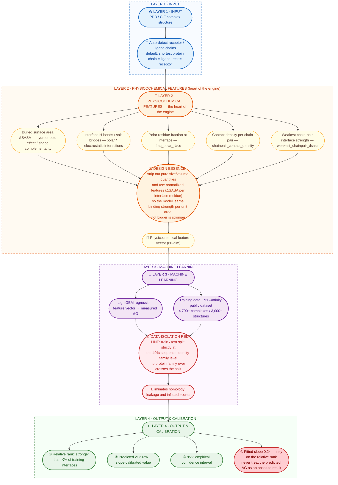

# Affinity Intelligence — Protein–Protein Binding Affinity Ranking Engine

**English** | [中文 README](README.md)

> A **relative ranking** engine for protein–protein binding affinity (ΔG),
> built on **physicochemical interface features + LightGBM**.
> Give it a complex 3D structure; it tells you whether that interface is
> strong or weak relative to known data.

---

## 1. Overview

### The problem we address

Conventional structural confidence metrics (e.g. **ipTM**, **ipSAE**) answer
*"can these two proteins bind?"* — a **classification** question.
They do **not** answer *"how tightly do they bind?"* — a **regression** question.

In real research and competition settings, the final judge is the
**wet-lab measured affinity (Kd)**. Predicting absolute Kd remains an open
problem, so this project deliberately does **not** aim for absolute
quantification. Instead, it builds a **physicochemical-feature-based relative
affinity ranking engine oriented toward wet-lab prioritization**.

### The value proposition in one sentence

> It does not tell you *how tightly* your candidate binds (absolute Kd),
> but among hundreds of candidates it tells you **which few are most likely to
> bind tightest in a wet-lab assay** — substantially improving hit rate.

---

## 2. Algorithm: Design Philosophy and Data-Flow Architecture

> This chapter describes the **engine's design thinking and data flow**,
> not line-by-line code details.

### 2.1 Four-layer architecture (data-flow diagram)



> The diagram above renders natively on GitHub (Mermaid is supported out of the box).
> If your Markdown viewer does not support Mermaid, refer to the layer-by-layer
> description in Section 2.2 below.

### 2.2 Layer-by-layer description

**Layer 1 · Input**
Accepts a 3D structure of a protein complex (PDB file) and automatically
identifies receptor and ligand chains. Chains can be specified manually, or
inferred automatically (shortest protein chain = ligand).

**Layer 2 · Physicochemical feature layer (the heart of the engine)**
Extracts features that reflect the **real binding driving force**. The critical
design trade-off here is the **deliberate removal of size/volume information**.
A large, loose interface naturally has more contacts and a bigger buried area.
Feeding those absolute quantities to the model would teach it the spurious
correlation *"bigger is stronger"* rather than the underlying binding mechanism.

Two techniques are used:
- **Normalization** — turn absolute quantities into intensity quantities:
  `ΔSASA / interface residues`, `contacts / chain pairs`, `H-bonds / contacts`;
- **Replacement** — use quantities such as *"weakest chain-pair interface
  strength"*, which capture the **weakest link in a multi-point binding mode**,
  in place of *"total contact count"*, which grows monotonically with size.

**Layer 3 · Machine-learning layer**
A LightGBM gradient-boosted regressor learns the non-linear mapping
*feature vector → measured ΔG* on the PPB-Affinity public dataset.

Data isolation is the **red line** of this layer: the train/test split is
performed at the **40% sequence-identity family level** (single-linkage or
greedy-representative clustering, then whole families assigned to one side),
so that no protein family ever crosses the split. This step is essential —
we measured that with PDB-level splitting only, roughly **30% of test samples
belonged to homologous families already seen in training**, inflating the
reported metrics to unrealistic levels.

**Layer 4 · Output and calibration layer**
- **Relative rank** (*"stronger than X% of training interfaces"*) — the most
  reliable output;
- **Predicted ΔG** (raw + slope-calibrated), with a **95% empirical interval**;
- An explicit usage warning: absolute values are shrunk (fitted slope **0.24**);
  rely on the relative rank.

---

## 3. Model Performance

Measured on a **cross-family isolated** test set:

| Metric | Value |
|---|---|
| **Spearman (primary metric, rank consistency)** | **0.534** |
| 95% confidence interval | [+0.487, +0.580] |
| **RMSE** | **2.37 kcal/mol** |
| MAE | 1.78 kcal/mol |
| R² | 0.261 |
| Test set | **950 rows / 437 unseen families / 580 structures** |
| Training set | 3,800 rows / 1,973 families |
| Permutation test | **18.1σ** above the random baseline |

**Version history (all under the family-isolation protocol)**

| Version | Training data | Test Spearman |
|---|---|---|
| V0.2 (initial) | 397 rows | +0.409 |
| V1.0 (7× more data) | 2,888 rows | +0.469 |
| **V1.1 (current, full)** | **4,750 rows** | **+0.534** |

**Top-5 feature importance**

| Rank | Feature | Physical meaning |
|---|---|---|
| 1 | `frac_polar_iface` | polar residue fraction at the interface |
| 2 | `n_contact_pairs` | interface contact atom pairs |
| 3 | `n_res_lig` | ligand chain residue count |
| 4 | `chainpair_contact_density` | mean contacts per chain pair (new in V0.3) |
| 5 | `frac_helix_iface` | helical fraction at the interface |

> Full importance table: `features/v1.1_feature_importance.csv`.
> Full evaluation report: `features/v1.1_final_report.md`.

---

## 4. Installation

```bash
pip install -r requirements.txt
```

Core dependencies: `pandas`, `numpy`, `scipy`, `scikit-learn`, `lightgbm`,
`biopython`, `freesasa`, `matplotlib`, `streamlit`.

**Notes & troubleshooting**
- The project is **CPU-only**; no GPU needed, and it does **not** depend on
  PyTorch or TensorFlow.
- On Windows, if `import lightgbm` fails with
  `lib_lightgbm.dll ... not found`, the usual cause is a missing OpenMP
  component (`vcomp140.dll`) from the VC++ runtime. This project already
  includes a workaround (it reuses the DLL bundled with scikit-learn).
  If it still fails, install the
  [Microsoft Visual C++ Redistributable](https://aka.ms/vs/17/release/vc_redist.x64.exe).
- `freesasa` computes SASA (solvent-accessible surface area) and underpins the
  ΔSASA features.

---

## 5. Usage

### 5.1 Command line

```bash
# explicit chains
python scripts/predict_affinity.py --pdb data/pdb/1A22.pdb --ligand A --receptor B

# chains inferred automatically (shortest protein chain = ligand)
python scripts/predict_affinity.py --pdb data/pdb/1ACB.pdb

# optional flags
#   --model <path>     specify a model file (default: models/affinity_engine_v1.1.pkl)
#   --no-calibrate     disable slope calibration
```

Example output:

```
--- Interface ---
Ligand chains : A   Receptor chains: B
Contact pairs : 766   H-bonds: 18   Salt bridges: 6   Buried ΔSASA: 2665 Ų

Predicted ΔG (raw)   : -10.99 kcal/mol
Slope-calibrated     : -13.86 kcal/mol  (test-set slope = 0.24, shrunk toward mean)
Relative rank        : stronger than 64.9% of training interfaces
Qualitative call     : moderately strong
95% interval (raw)   : [-15.62, -6.36] kcal/mol
```

### 5.2 Streamlit front end

**Option A — Windows one-click launcher (recommended for non-CLI users)**

Simply **double-click** `run_app.bat` in the project root. The script will
locate a Python interpreter, check whether Streamlit is installed (and offer to
install the dependencies if it is not), then start the app and open your browser.

**Option B — command line**

```bash
cd <project root>
python -m streamlit run app.py
```

Then open `http://localhost:8501`.

Features:
- Two input sources: pick a structure from `data/pdb/`, or **upload a PDB file**
  (uploads are written to a temporary file and deleted right after prediction,
  so your data directory is never polluted);
- Chain selectors with an "auto-infer shortest chain" option;
- Results area: large-font **relative rank**, raw / calibrated ΔG, 95% empirical
  interval, and a bar chart of the candidate's top-5 physical features.

> Tip: if the `streamlit` command is not found, use
> `python -m streamlit run app.py` (on some systems pip's Scripts directory is
> not on `PATH`).

### 5.3 Use as a Python library

```python
import sys
sys.path.insert(0, "scripts")
from predict_affinity import get_prediction

r = get_prediction("data/pdb/1A22.pdb", ligand_chain="A", receptor_chain="B")
print(r["raw_dG"], r["calibrated_dG"], r["rank_pct"])
print(r["top_features"])          # [(feature_name, value), ...]
```

---

## 6. Interpreting the Results ⚠️ IMPORTANT

> ### ⚠️ Model absolute values are shrunk (fitted slope 0.24).
> ### Rely on the **relative rank**; do **not** treat the predicted ΔG
> ### as an absolute quantitative result.

What this means concretely:

1. **Predicted ΔG is strongly compressed toward the training-set mean.**
   The slope of a linear fit of *predicted vs. measured* on the test set is only
   about **0.24** (perfect calibration would be 1.0). Genuinely weak interfaces
   are predicted too strong, and genuinely strong ones too weak —
   **the ordering is still correct, but the absolute magnitude is distorted.**
2. **The slope-calibrated ΔG** rescales the prediction by that slope; it is
   closer to the true magnitude but also **amplifies noise**, widening the
   interval. Use with caution.
3. **Recommended use**: treat the output as an **enrichment / triage tool** —
   use the *"stronger than X%"* rank to pick the few candidates most worth
   taking into a wet-lab assay.
4. The interval is an **empirical interval derived from test-set RMSE**
   (±1.96 × RMSE); it is not a rigorous posterior predictive interval.

---

## 7. Limitations

1. **Physical features only — no sequence language-model features.**
   The current version relies entirely on geometric and physicochemical
   quantities of the complex interface (ΔSASA, H-bonds, salt bridges, contacts,
   residue composition). **ESM-2 or other protein language-model embeddings are
   not used.** Evolutionary and co-evolutionary information from sequence is
   thus unexploited — one of the main ceilings on current performance.
2. **PRODIGY unavailable.** We intended to include PRODIGY's empirical energy
   term (predicted ΔG) as a feature, but the dependency was unavailable in the
   target environment, so the `predicted_dG` column is entirely missing and the
   model uses geometry/physicochemical features only.
3. **Limited training data.** The current model uses ~3,000 structures /
   4,750 interface samples from PPB-Affinity, not the full dataset; more
   structures should help (going from 397 → 4,750 rows raised Spearman from
   0.409 to 0.534).
4. **Homology assignment is a proxy.** Family isolation uses clustering at a
   **40% sequence-identity** threshold (greedy CD-HIT-style representative
   clustering at large scale). This is an approximation of homology; remote
   same-fold relationships (e.g. between TIM-barrel families) may not be
   covered.
5. **Quantitative ability is weaker than ranking ability.** See Section 6 —
   fitted slope 0.24; absolute ΔG must not be taken at face value.
6. **Applicability boundary.** Trained on protein–protein complexes; may not
   apply to systems with many non-standard residues/ligands/nucleic acids,
   to systems with large conformational change (induced fit), or to binding
   modes not represented in the training data.

---

## 8. Repository Layout

```
.
├── app.py                              # Streamlit front end
├── run_app.bat                         # Windows one-click launcher
├── requirements.txt
├── LICENSE                             # MIT License
├── CITATION.cff                        # citation metadata (enables "Cite this repository")
├── README.md                           # Chinese README
├── README_EN.md                        # English README (this file)
├── models/
│   └── affinity_engine_v1.1.pkl        # trained LightGBM model (~0.7 MB)
├── features/
│   ├── train_stats.csv                 # training stats (rank quantiles + medians; required)
│   ├── v1.1_feature_importance.csv     # feature importance ranking
│   ├── v1.1_final_report.md            # full V1.1 evaluation report (primary)
│   ├── v1.0_final_report.md            # V1.0 report (historical comparison)
│   └── v1_family_split_report.md       # family-split report (isolation evidence)
├── data/
│   └── pdb/
│       ├── 1A22.pdb                    # example structure (hGH–hGHbp)
│       └── 1ACB.pdb                    # example structure (chymotrypsin–Eglin c)
└── scripts/
    ├── 01_clean_data.py               # data cleaning + label conversion (Kd → ΔG)
    ├── 02a_fetch_pdb.py               # structure download
    ├── 02_extract_features.py         # feature extraction (geometry + sequence + SASA)
    ├── 03_train_model.py              # baseline training (V0.1)
    ├── 04_family_split.py             # family split (MVP scale)
    ├── 05_train_v0.2.py               # V0.2 training & comparison
    ├── 06_train_v0.3.py               # V0.3 chain-pair physics features
    ├── 07_extract_features_full.py    # full-scale extraction (resumable)
    ├── 08_train_v1.0.py               # V1.0 training
    ├── 09_family_split_full.py        # full family-level split (hard red-line check)
    ├── 10_extract_remaining.py        # remaining structures (temp-file-free SASA)
    ├── 11_train_v1.1.py               # final V1.1 training
    └── predict_affinity.py            # inference module (CLI + reusable function)
```

---

## 9. Data & Acknowledgements

If you use this project in academic work, please cite this repository — the
**"Cite this repository"** button on the repository page generates APA / BibTeX
entries from [`CITATION.cff`](CITATION.cff).

- Training data: **PPB-Affinity** — a public protein–protein binding affinity
  dataset (Liu, H. *et al.*, DOI [10.5281/zenodo.11070823](https://doi.org/10.5281/zenodo.11070823)).
- Gradient boosting: [LightGBM](https://github.com/microsoft/LightGBM) (Ke, G. *et al.*, NeurIPS 2017).
- SASA calculation: [FreeSASA](https://github.com/mittinatten/freesasa) (Mitternacht, S., *F1000Research* 2016).
- Structure parsing: [Biopython](https://biopython.org/).
- Example structures from [RCSB PDB](https://www.rcsb.org/).
- Evaluation discipline: every reported metric is measured on a
  **family-isolated** test set. The split report
  (`features/v1_family_split_report.md`) is included so the protocol can be
  independently reviewed.

---

## 10. License

**This project is released under the MIT License.** See the [`LICENSE`](LICENSE)
file in the repository root for the full text.

```
MIT License — Copyright (c) 2026 KELE
You are free to use, modify and distribute this project (including for
commercial purposes), provided the copyright notice and license notice are
retained. The software is provided "as is", without warranty of any kind.
```

### Licensing of the training data (important)

- **Project code and the trained model**: MIT License.
- **Training data (PPB-Affinity)**: governed by **its own original license
  terms** and is *not* covered by this project's MIT grant. This project used
  the public dataset only to train the model and **does not redistribute the
  raw dataset**. If you wish to reproduce the training pipeline or redistribute
  the data, please review and comply with PPB-Affinity's original license.
- The two example structures under `data/pdb/` (`1A22.pdb`, `1ACB.pdb`) come
  from **RCSB PDB** and are likewise subject to RCSB PDB's terms of use.

